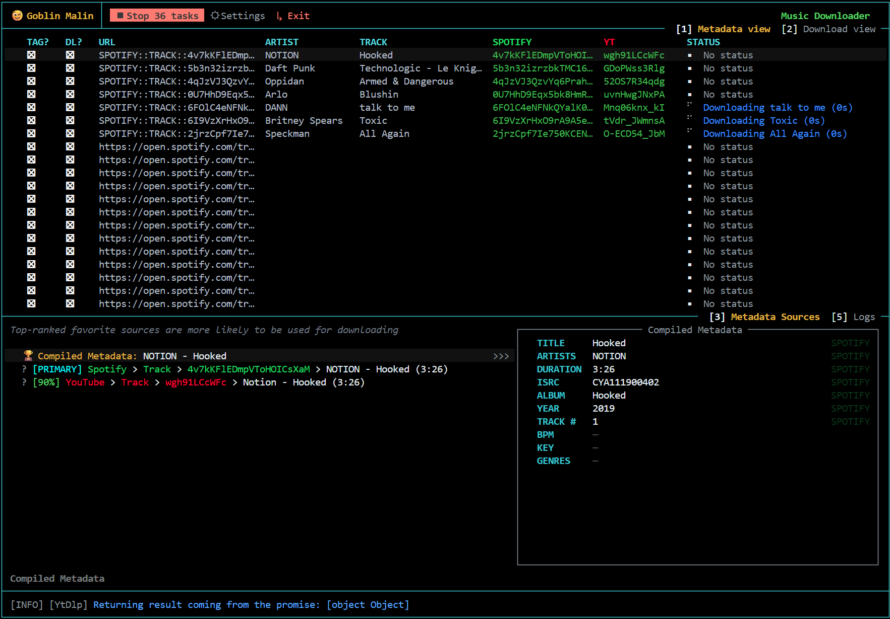
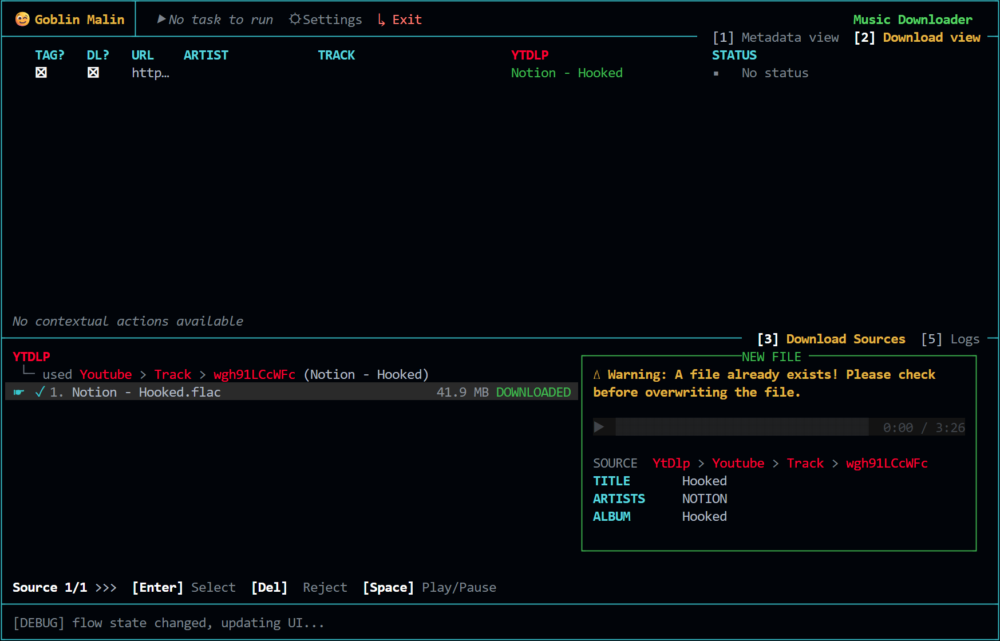

# goblin-malin 😉

- [goblin-malin 😉](#goblin-malin-)
    - [What it does](#what-it-does)
    - [Installation](#installation)
        - [Installation with `npm` (RECOMMENDED)](#installation-with-npm-recommended)
        - [Installation with `yarn`](#installation-with-yarn)
        - [Installation with `pnpm`](#installation-with-pnpm)
        - [Installation on Windows](#installation-on-windows)
        - [Installation on macOS](#installation-on-macos)
        - [Installation on Linux](#installation-on-linux)
    - [First run](#first-run)
    - [Steps](#steps)
    - [Keyboard](#keyboard)
    - [Where your data lives](#where-your-data-lives)
    - [Privacy](#privacy)
    - [Troubleshooting](#troubleshooting)
    - [Running the project as a developer](#running-the-project-as-a-developer)
    - [Launching the app through js code](#launching-the-app-through-js-code)
    - [License](#license)
    - [Screenshots](#screenshots)
        - [Metadata view](#metadata-view)
        - [Download view](#download-view)

> [!CAUTION]
> **This project is in early, early, early development.**<br>
> Be aware that the data model can change drastically, making previous versions incompatible with the current one. Use at your own risk 😉

A keyboard-driven terminal UI for downloading and tagging music tracks with metadata. Import links from Spotify and YouTube, the app cross-references metadata across providers, finds the best download source, and saves it to disk as a tagged FLAC.

## What it does

- **Import** Spotify and YouTube (Music) links: tracks, **albums and playlists** from Spotify, tracks and playlists from YouTube (a playlist can keep refreshing itself). Plain links, links without `https://` and `spotify:track:…` URIs are understood.
- **Cross-reference** the same track on other platforms to compare and merge metadata: **MusicBrainz**, plus **Songlink** and **Claude** if you opt in (see [Privacy](#privacy)). Every field can be edited or copied.
- **Find download sources** from **yt-dlp** (YouTube) and **Soulseek**, preview them in the app (through `mpv`), compare them, and pick the best one.
- **Save** the chosen source to your output folder as a **FLAC** with clean tags, replacing a previously saved file if you want to.
- **Sessions and archive**: your task list is saved and re-opened on the next start; you can keep several sessions and archive finished tasks.
- **Everything is configurable**: providers, folders, concurrency, themes and every keyboard shortcut (Settings). The mouse works too.

## Installation

You need [Node.js](https://nodejs.org/en/download) **22 or newer**.

### Installation with `npm` (RECOMMENDED)

```bash
npm install -g goblin-malin
goblin-malin # Run application
```

### Installation with `yarn`

```bash
yarn global add goblin-malin
```

> `yarn global` only exists in Yarn 1 (classic). Yarn 2 and newer removed it: use `npm` or `pnpm` instead.

<details>
<summary>Don't forget to add your `yarn` directory to your PATH to have the command `goblin-malin` available in any terminal.</summary>

On windows:

```ps1
$yarBin = "C:\Users\YOUR_USERNAME\AppData\Local\Yarn\bin"
$current = [System.Environment]::GetEnvironmentVariable("PATH", "User")
[System.Environment]::SetEnvironmentVariable("PATH", "$current;$yarBin", "User")
```

</details>

### Installation with `pnpm`

```bash
pnpm add -g goblin-malin
```

### Installation on Windows

Install with any of the package managers above (`npm` is the simplest), e.g. in PowerShell:

```ps1
npm install -g goblin-malin
goblin-malin
```

`yt-dlp`, `ffmpeg` and `mpv` (for in-app audio playback) are downloaded automatically on first run.

### Installation on macOS

Install with any of the package managers above, e.g.:

```bash
npm install -g goblin-malin
goblin-malin
```

`yt-dlp` and `ffmpeg` are downloaded automatically on first run (ffmpeg comes
from [evermeet.cx](https://evermeet.cx/ffmpeg/)). To enable in-app audio
playback, install [`mpv`](https://mpv.io/) — it is picked up from your `PATH`:

```bash
brew install mpv
```

### Installation on Linux

Linux is **not supported yet**: the app installs and starts, but its automatic `ffmpeg` / `ffprobe` download fetches a Windows build that cannot run on Linux (and the app deliberately never falls back to an `ffmpeg` from your `PATH`), so saving tracks does not work yet. `mpv` (playback) is picked up from your `PATH` as on macOS.

## First run

- A short **welcome tour** plays (when animations are on; turn it off in Settings → _Show welcome tutorial on start-up_).
- The app downloads the tools it needs (`yt-dlp`, `ffmpeg`, `ffprobe`, and on Windows `mpv`) into the [data folder](#where-your-data-lives) and tells you if one cannot be found or downloaded.
- Credentials are asked for **when a provider needs them** (or run Settings → _⚙ Setup Wizard_):
    - **Spotify** — either your own Spotify API app (client id + secret from the [developer dashboard](https://developer.spotify.com/dashboard); needs a Premium account) for full metadata (album, ISRC, track number), or the no-credentials mode, which reads the public page and gives less.
    - **Soulseek** — your Soulseek username and password.

    They are saved in the `.env` file of the data folder, in plain text. See [.env.example](.env.example) for the format.

- **Songlink** and **Claude** are off until you allow them once (a dialog explains what is sent).
- Pick your **output folder** in Settings → Download → _Default output directory_.

## Steps

- Import with `Ctrl+V` URLs from compatible streaming platforms :
    - `Spotify` (tracks, albums, playlists)
    - `YouTube` / `YouTube Music` (tracks, playlists)
- System fetches primary metadata from the corresponding URL platform
- System discovers the same track on other platforms (cross-referencing via ISRC or track/artist name)
- Filters/orders metadata sources by relevance or leaves the default ranking chosen by the system (use `TAB` key to switch the focused window).
- System searches matching tracks from the enabled download providers:
    - `yt-dlp`
    - `Soulseek` (off by default: enable it in Settings → Download → Providers)
- User selects the best download source and previews the audio
- User saves the file to the desired folder with embedded tags

## Keyboard

Every shortcut can be rebound in Settings → _Shortcuts_, and the hints at the bottom of the screen always show the live binding. The defaults:

| Key                        | What it does                                                                                                                                                                             |
| -------------------------- | ---------------------------------------------------------------------------------------------------------------------------------------------------------------------------------------- |
| `Ctrl+V`                   | Import the links on the clipboard (a link pasted while a text field has focus stays in that field)                                                                                       |
| `Ctrl+Q`                   | **Quit**, from anywhere. Asks first; press `Ctrl+Q` again (right away, or while the question is up) to quit at once. Closing waits for your session to be saved. `Ctrl+C` does not quit. |
| `Tab`                      | Switch the focused panel                                                                                                                                                                 |
| `Esc` `Esc`                | Focus the toolbar (`←` `→` to move, `Enter` to press a button, `↓` to go back to the tasks)                                                                                              |
| `↑` `↓`                    | Move in the task list; `←` `→` change column                                                                                                                                             |
| `Shift+↑` `Shift+↓`        | Shrink / grow the secondary panel                                                                                                                                                        |
| `Ctrl+A`, `Ctrl+Shift+↑/↓` | Select all tasks, or extend the selection by a range (`Esc` clears it). Most actions work on the whole selection.                                                                        |
| `R`                        | Start / restart the focused task                                                                                                                                                         |
| `F` / `D`                  | Re-fetch primary metadata / re-discover on the other providers                                                                                                                           |
| `W`                        | Search download sources                                                                                                                                                                  |
| `Enter`                    | Run the cell's action (toggle tagging or downloading, open a link, …)                                                                                                                    |
| `Del`                      | Archive or delete the task                                                                                                                                                               |
| `Ctrl+C`                   | Copy the focused value                                                                                                                                                                   |
| `1` `2`                    | Metadata mode / download mode                                                                                                                                                            |
| `3` `4` `5`                | Metadata sources / download sources / logs tab                                                                                                                                           |
| `Space`, `Ctrl+P`          | Play a source / pause or resume playback                                                                                                                                                 |
| `S`                        | Save the selected source to the output folder (in the download panel)                                                                                                                    |
| `Ctrl+F`                   | Relocate a saved file that moved                                                                                                                                                         |
| `F3`                       | Toggle the stats overlay                                                                                                                                                                 |

The mouse works as well: click to focus and select, scroll, click the toolbar buttons.

## Where your data lives

Everything is in one folder, which you can move with the `GOBLIN_DATA_DIR` environment variable (set it in your shell, not in `.env`):

| System                               | Default data folder                                           |
| ------------------------------------ | ------------------------------------------------------------- |
| Windows                              | `%APPDATA%\goblin-malin`                                      |
| macOS                                | `~/Library/Application Support/goblin-malin`                  |
| Linux                                | `$XDG_DATA_HOME/goblin-malin` (`~/.local/share/goblin-malin`) |
| Running from source (`yarn run dev`) | `data/` in the repository                                     |

| Inside the folder          | What it is                                                                     |
| -------------------------- | ------------------------------------------------------------------------------ |
| `settings.json`            | Your settings and shortcuts                                                    |
| `sessions.json` (+ `.bak`) | Your task list and sessions                                                    |
| `.env`                     | Spotify and Soulseek credentials, in plain text                                |
| `cache/`                   | Cached provider answers (Settings → _Clear cache_)                             |
| `bin/`                     | Downloaded tools (`yt-dlp`, `ffmpeg`, `ffprobe`, `mpv`) and your `cookies.txt` |
| `app.log`, `app.prev.log`  | The log of this session and of the previous one (also in the Logs tab)         |

Saved tracks go to the _Default output directory_; unsaved downloads wait in the _Temporary download directory_ (Settings → Download, where you can also clear them). Other environment variable: `GOBLIN_NO_AUDIO=1` never starts `mpv` (no preview, no intro sound). Only one Goblin Malin can run per data folder.

## Privacy

There is no telemetry and no account. The app talks to these services, and only as needed:

| Service                                   | When                                                                                                                                                                   | What is sent                                                                                                                                                                            |
| ----------------------------------------- | ---------------------------------------------------------------------------------------------------------------------------------------------------------------------- | --------------------------------------------------------------------------------------------------------------------------------------------------------------------------------------- |
| Spotify, YouTube / YouTube Music          | You import a link of that platform, and whenever a download runs (`yt-dlp` searches and downloads from YouTube; your `cookies.txt`, if you added one, is sent with it) | The link, or a search for the track                                                                                                                                                     |
| MusicBrainz                               | Discovery (on by default)                                                                                                                                              | Track title, artists, ISRC                                                                                                                                                              |
| Soulseek network                          | You enable the Soulseek provider (off by default)                                                                                                                      | Your Soulseek login and the search terms (artist, title). It is a peer-to-peer network: the users you download from can see your IP address                                             |
| `api.github.com`, `github.com`            | At start-up, to **check for a new version** (turn it off in Settings → _Check for updates on start-up_), and to download `yt-dlp`, `ffmpeg` and (on Windows) `mpv`     | A plain request, no data about you                                                                                                                                                      |
| `evermeet.cx` (macOS)                     | Downloading `ffmpeg`                                                                                                                                                   | A plain request                                                                                                                                                                         |
| **Songlink** (`api.song.link`) — _opt-in_ | After you allowed it                                                                                                                                                   | The link of each track                                                                                                                                                                  |
| **Claude** — _opt-in, last resort_        | After you allowed it, for tracks nothing else found                                                                                                                    | Title, artists, album, release date, ISRC, duration and source link, through the Claude Code CLI installed on your computer and **your own Claude account** (it uses part of your plan) |

Songlink and Claude stay off until you allow them in a dialog; you can change your mind in Settings → Metadata → Discovery providers.

## Troubleshooting

- **YouTube says "Sign in to confirm you're not a bot", or a download fails with HTTP 403** — give `yt-dlp` your browser's cookies: export them in the Netscape format (a browser extension such as _Get cookies.txt LOCALLY_ does it) and save the file as `cookies.txt` in the `bin/` folder of the [data folder](#where-your-data-lives). It is used on the next download.
- **"ffmpeg/yt-dlp could not be found or downloaded"** — the dialog says why (usually no network, or a proxy/antivirus blocking the download). Fix the cause and restart the task; the tool is downloaded again. On Linux, see [Installation on Linux](#installation-on-linux).
- **Nothing plays / "mpv"** — preview needs [`mpv`](https://mpv.io/). Windows downloads it for you; on macOS and Linux install it so that `mpv` is on your `PATH`. Check that `GOBLIN_NO_AUDIO` is not set.
- **Spotify tracks have no album or ISRC** — you are in the no-credentials mode. Run Settings → _⚙ Setup Wizard_ and enter your own Spotify API app.
- **Songlink stops answering** — its free quota is about 19 lookups per hour; wait, or leave Songlink off for big imports.
- **The layout is garbled** — the window is too narrow: make the terminal at least about 66 columns wide.
- **"Goblin Malin is already running"** — close the other window, or, if none is open, delete the lock file the message names.
- **Something else** — look at the Logs tab (`5`) or at `app.log`, then [open an issue](https://github.com/Tetraxel/goblin-malin/issues) with the log.

## Running the project as a developer

You can run the project as a developer:

1. Clone the repository and open a terminal in the project directory
2. Install [Node.js](https://nodejs.org/en/download) (22 or newer) and [yarn](https://classic.yarnpkg.com/lang/en/docs/install)
3. Install dependencies in the project directory: `yarn install`
4. Run the application: `yarn run dev`

Before sending a change: `yarn run type-check`, `yarn run lint`, `yarn run format:check` and `yarn test`. A map of the code is in [docs/ARCHITECTURE.md](docs/ARCHITECTURE.md); the roadmap is in [docs/projects/](docs/projects/README.md) and [TODO.md](TODO.md).

## Launching the app through js code

> Not customizable yet

```js
import GoblinMalin from "goblin-malin";

GoblinMalin.start();
```

## License

[PolyForm Noncommercial License 1.0.0](LICENSE): free for personal and other noncommercial use, **not** for commercial use.

## Screenshots

### Metadata view



### Download view


