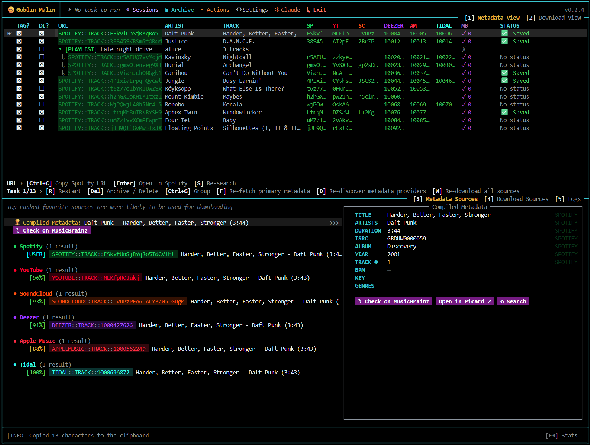
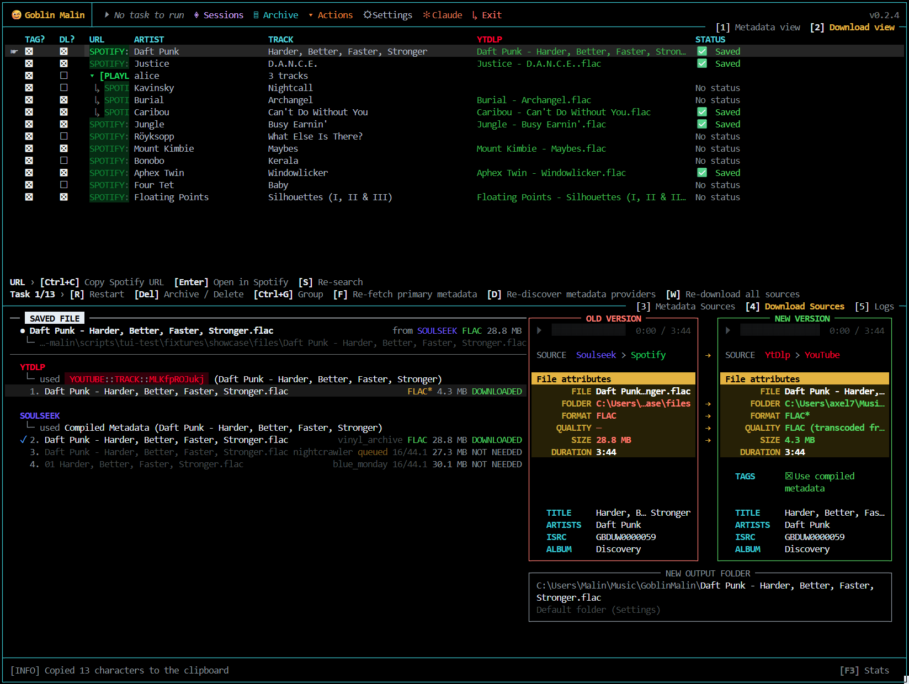
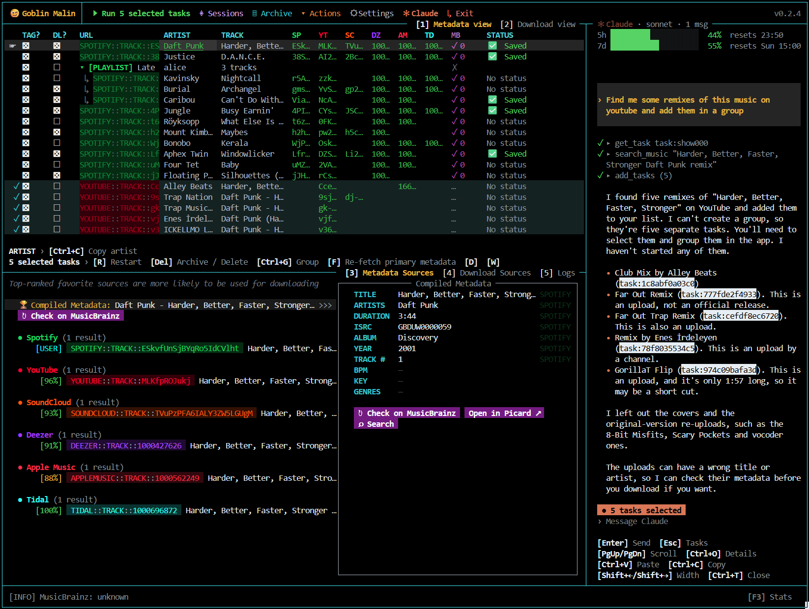
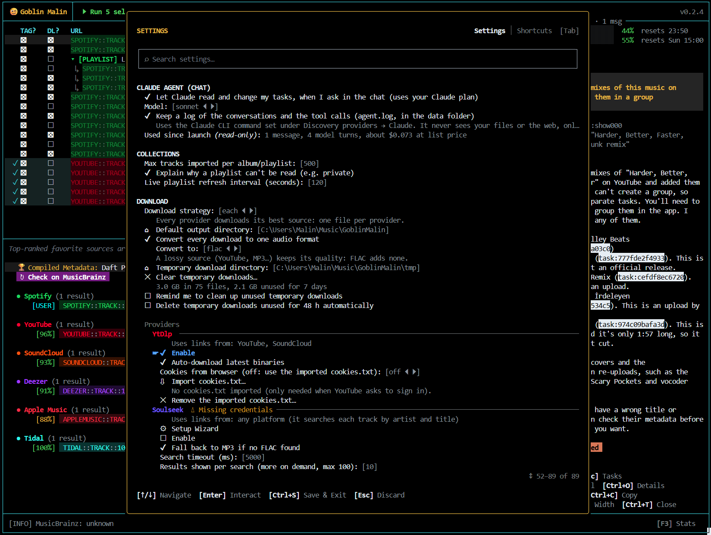

<h1 align="center">goblin-malin 😉</h1>

<p align="center">
  <b>Paste a music link. Get a properly tagged audio file.</b><br/>
  A keyboard-driven terminal app that finds your tracks on every platform, compares the metadata,<br/>
  picks the best source and saves a clean, tagged file, <b>FLAC</b> by default.
</p>

<p align="center">
  <a href="https://www.npmjs.com/package/goblin-malin"></a>
  
  
  <a href="LICENSE"></a>
</p>

<p align="center">
  
</p>

```bash
npm install -g goblin-malin
goblin-malin
```

Then press **`Ctrl+V`** with a Spotify, YouTube, SoundCloud, Deezer, Apple Music or Tidal link on your clipboard. That's it.

- [At a glance](#at-a-glance)
- [How it works](#how-it-works)
- [A closer look](#a-closer-look)
- [What it can read, search and download](#what-it-can-read-search-and-download)
- [Install](#install)
- [First run](#first-run)
- [Keyboard](#keyboard)
- [Privacy](#privacy)
- [Where your data lives](#where-your-data-lives)
- [Troubleshooting](#troubleshooting)
- [Contributing](#contributing) · [License](#license)

## At a glance

- **One paste, one file.** Tracks, albums and playlists from six platforms. A whole playlist is a single paste.
- **It finds each track everywhere.** The same song is looked up on the other platforms and the details (title, artists, album, year…) are merged into one set that you can edit.
- **It tells you the real quality.** Every download is listed with its true format and size, so a FLAC made from a YouTube video is not mistaken for a real lossless file.
- **Clean, tagged files.** FLAC by default, or MP3, Ogg, Opus or M4A, with tags that iTunes, your phone and MusicBrainz Picard can read.
- **What you type is yours.** A link you pasted or a title you corrected is never wiped by a restart, and anything that would throw work away asks first.
- **Private.** No account, no telemetry.
- **Claude can help, if you want it to.** Entirely optional, through your own Claude account.
- **Made for the keyboard**, with the mouse working too.

## How it works

1. **Paste** a track, album or playlist link, choose whether to tag and download it, and press **Run**. The app recognises the platform and reads the track.
2. **It looks for the same track elsewhere**, on all the other platforms at once. Each one shows up as a group with a confidence score.
3. **It searches for files to download** with yt-dlp and Soulseek, and lists the candidates side by side.
4. **You pick one.** Preview the candidates, compare them, and keep the best (the app suggests one).
5. **It saves the file** in the format you chose, with clean tags.

When a source can't be found (an unofficial re-upload, say), **paste the right link yourself** onto the track: it is kept for good.

## A closer look

### Pick the best source



- Candidates from **yt-dlp** (YouTube, SoundCloud) and **Soulseek** are shown with their real format, bitrate and size.
- A `FLAC*` was converted from a lossy source (YouTube's Opus, for instance): it is not pretending to be lossless.
- Play any candidate before you choose. When you replace a file you already saved, the old and the new version are shown next to each other.

### Let Claude help (optional)



- **Chat** (`Ctrl+T`): ask for things like "fix the titles in this playlist" or "find remixes of this track". Claude reads and edits your tracks, shows a preview before changing many at once, asks before downloading anything, and you can undo with `/undo`. It never touches a file itself.
- **Ask Claude** (`A`): when a platform is still missing for a track, one button asks Claude to look for it.
- It runs through the [Claude Code](https://claude.com/claude-code) CLI on your computer and your own plan, only after you allow it. No API key needed.

### Make it yours



- Choose the **providers**, the **output format** (or keep each download as it came), the **folders** and how many tracks run at once.
- Every **keyboard shortcut** can be rebound, and the hints on screen always show your own keys.
- Your list is saved as a **session** and re-opened next time. Keep several, and archive what is finished.

## What it can read, search and download

| Platform                    | Paste a…               | Searched during discovery                  | Downloaded by                       |
| --------------------------- | ---------------------- | ------------------------------------------ | ----------------------------------- |
| **Spotify**                 | track, album, playlist | yes                                        | — (metadata only; Soulseek by name) |
| **YouTube / YouTube Music** | track, playlist        | yes                                        | yt-dlp                              |
| **SoundCloud**              | track, playlist, album | yes                                        | yt-dlp                              |
| **Deezer**                  | track, album, playlist | yes (by ISRC first)                        | — (Soulseek by name)                |
| **Apple Music**             | track, album           | yes                                        | — (Soulseek by name)                |
| **Tidal**                   | track                  | via a pasted link, Songlink or MusicBrainz | — (Soulseek by name)                |

Discovery also uses **MusicBrainz** (on by default), **Songlink** and **Claude** (both opt-in and on request: a button under the track's sources asks them, or turn on "search automatically" in their settings). Soulseek is off by default: turn it on in Settings → Download.

Platforms whose streams are protected (Spotify, Deezer, Apple Music, Tidal) are used for what they know best, **metadata**; the audio itself comes from yt-dlp or Soulseek.

## Install

You need [Node.js](https://nodejs.org/en/download) **22 or newer**.

```bash
npm install -g goblin-malin
goblin-malin
```

<details>
<summary><b>yarn / pnpm</b></summary>

```bash
pnpm add -g goblin-malin
yarn global add goblin-malin
```

> `yarn global` only exists in Yarn 1 (classic). Yarn 2 and newer removed it: use `npm` or `pnpm` instead. Add your `yarn` bin folder to your `PATH` so that `goblin-malin` is found in any terminal (on Windows: `%LOCALAPPDATA%\Yarn\bin`).

</details>

| System      | Status                                                                                                                                                                                                                                                  |
| ----------- | ------------------------------------------------------------------------------------------------------------------------------------------------------------------------------------------------------------------------------------------------------- |
| **Windows** | Supported. `yt-dlp`, `ffmpeg` and `mpv` (for in-app audio preview) are downloaded automatically on first run.                                                                                                                                           |
| **macOS**   | Supported. `yt-dlp` and `ffmpeg` are downloaded automatically (ffmpeg from [evermeet.cx](https://evermeet.cx/ffmpeg/)). For in-app preview, `brew install mpv`.                                                                                         |
| **Linux**   | **Not supported yet.** The app starts, but its automatic `ffmpeg` download fetches a Windows build, so saving tracks does not work (it deliberately never falls back to an `ffmpeg` from your `PATH`). `mpv` is picked up from your `PATH` as on macOS. |

A terminal at least **66 columns** wide is needed; the Claude chat docks beside the list from **108 columns**.

## First run

1. A short **welcome tour** plays (turn it off in Settings → _Show welcome tutorial on start-up_).
2. One screen asks **which download providers** and **which platforms** to use. A grid shows, in each platform's color, whose links each download provider will use; untick a platform and its link greys out. `Enter` ticks a row, `Ctrl+S` saves. Settings → Metadata / Download change it later.
3. The tools it needs (`yt-dlp`, `ffmpeg`, `ffprobe` and, on Windows, `mpv`) are downloaded into the [data folder](#where-your-data-lives); a dialog tells you if one can't be found.
4. Credentials are asked for **when a provider needs them** (or run Settings → _⚙ Setup Wizard_):
    - **Spotify** — your own Spotify API app (client id + secret from the [developer dashboard](https://developer.spotify.com/dashboard); needs a Premium account) for full metadata (album, ISRC, track number), or the no-credentials mode, which reads the public page and gives less.
    - **Soulseek** — your Soulseek username and password.

    They are saved in the `.env` file of the data folder, in plain text. See [.env.example](.env.example).

5. **Songlink** and **Claude** stay off until you allow them once (a dialog explains what is sent).
6. Pick your **output folder** in Settings → Download → _Default output directory_.

## Keyboard

Every shortcut can be rebound in Settings → _Shortcuts_. The essentials:

| Key             | What it does                                                                                                                      |
| --------------- | --------------------------------------------------------------------------------------------------------------------------------- |
| `Ctrl+V`        | Import the links on the clipboard. On the **Metadata Sources** list or a **platform's cell**, add the link to _that track_.       |
| `↑` `↓` `←` `→` | Move in the task list and between columns                                                                                         |
| `Tab`           | Switch the focused panel                                                                                                          |
| `1` `2`         | Metadata view / Download view                                                                                                     |
| `3` `4` `5`     | Metadata sources / Download sources / Logs                                                                                        |
| `R`             | Start (or restart) the focused task. `F` re-fetches the metadata, `D` re-discovers on the other platforms, `W` searches downloads |
| `Space`         | Play a source (`Ctrl+P` pauses)                                                                                                   |
| `S`             | Save the selected source to the output folder                                                                                     |
| `A`             | Ask Claude to find a missing platform (opt-in)                                                                                    |
| `Ctrl+T`        | Open the Claude chat (opt-in)                                                                                                     |
| `Ctrl+G`        | Group the selected tracks under a name                                                                                            |
| `Ctrl+A`        | Select all tasks; `Ctrl+Shift+↑/↓` extends the selection. Most actions work on the whole selection                                |
| `Del`           | Archive or delete the task                                                                                                        |
| `Ctrl+Q`        | Quit (asks first; `Ctrl+C` does not quit)                                                                                         |

The hints at the bottom of the screen always show the live binding of whatever is focused. **Select any text by dragging over it** and it is copied when you let go (`Alt`+drag takes a rectangle; Settings → General can turn it off). The **Actions** button drops down things to do to the whole list, such as opening every track in MusicBrainz Picard.

## Privacy

There is no telemetry and no account. The app only talks to these services, and only as needed:

| Service                                   | When                                                                                                                         | What is sent                                                                                                                                                                |
| ----------------------------------------- | ---------------------------------------------------------------------------------------------------------------------------- | --------------------------------------------------------------------------------------------------------------------------------------------------------------------------- |
| Spotify, YouTube / YouTube Music          | You import a link of that platform, and whenever a download runs (yt-dlp searches and downloads; your `cookies.txt`, if any) | The link, or a search for the track                                                                                                                                         |
| SoundCloud, Deezer, Apple Music, Tidal    | You import a link of that platform, and during discovery (each can be switched off in Settings → Metadata)                   | The link or its id, the track's ISRC, or a search for its artist and title                                                                                                  |
| MusicBrainz                               | Discovery (on by default)                                                                                                    | Track title, artists, ISRC                                                                                                                                                  |
| Soulseek network                          | You enable the Soulseek provider (off by default)                                                                            | Your Soulseek login and the search terms. It is peer-to-peer: the users you download from can see your IP address                                                           |
| `api.github.com`, `github.com`            | At start-up, to **check for a new version** (can be turned off), and to download `yt-dlp`, `ffmpeg` and (on Windows) `mpv`   | A plain request, no data about you                                                                                                                                          |
| **Songlink** (`api.song.link`) — _opt-in_ | After you allowed it                                                                                                         | The link of each track                                                                                                                                                      |
| **Claude** — _opt-in_                     | Only when you click "Ask Claude", or when you chat (after allowing it once)                                                  | Track details (title, artists, album, date, ISRC, duration, link), through the Claude Code CLI on your computer and **your own Claude account** (it uses part of your plan) |

Songlink and Claude stay off until you allow them; you can change your mind in Settings.

## Where your data lives

One folder, which you can move with the `GOBLIN_DATA_DIR` environment variable (set it in your shell, not in `.env`).

| System                               | Default data folder                                           |
| ------------------------------------ | ------------------------------------------------------------- |
| Windows                              | `%APPDATA%\goblin-malin`                                      |
| macOS                                | `~/Library/Application Support/goblin-malin`                  |
| Linux                                | `$XDG_DATA_HOME/goblin-malin` (`~/.local/share/goblin-malin`) |
| Running from source (`yarn run dev`) | `data/` in the repository                                     |

| Inside the folder          | What it is                                                                     |
| -------------------------- | ------------------------------------------------------------------------------ |
| `settings.json`            | Your settings and shortcuts                                                    |
| `sessions.json` (+ `.bak`) | Your task list and sessions                                                    |
| `.env`                     | Spotify and Soulseek credentials, in plain text                                |
| `cache/`                   | Cached provider answers (Settings → _Clear cache_)                             |
| `bin/`                     | Downloaded tools (`yt-dlp`, `ffmpeg`, `ffprobe`, `mpv`) and your `cookies.txt` |
| `app.log`, `app.prev.log`  | The log of this session and of the previous one (also in the Logs tab)         |

Saved tracks go to the _Default output directory_; unsaved downloads wait in the _Temporary download directory_ (Settings → Download). `GOBLIN_NO_AUDIO=1` never starts `mpv` (no preview, no intro sound). Only one Goblin Malin can run per data folder.

## Troubleshooting

<details>
<summary><b>YouTube says "Sign in to confirm you're not a bot", or a download fails with HTTP 403</b></summary>

Give `yt-dlp` your browser's cookies. Settings → Download → YtDlp → _Import cookies.txt…_ walks you through it (export the cookies with a browser extension such as _Get cookies.txt LOCALLY_, drop the file on the terminal, done), or set _Cookies from browser_ to Firefox to let `yt-dlp` read them itself. It is used on the next download; the settings say how old the imported file is, since YouTube signs sessions out after a while.

</details>

<details>
<summary><b>"ffmpeg/yt-dlp could not be found or downloaded"</b></summary>

The dialog says why (usually no network, or a proxy/antivirus blocking the download). Fix the cause and restart the task. On Linux, see [Install](#install).

</details>

<details>
<summary><b>Nothing plays</b></summary>

Preview needs [`mpv`](https://mpv.io/). Windows downloads it for you; on macOS install it so that `mpv` is on your `PATH`. Check that `GOBLIN_NO_AUDIO` is not set.

</details>

<details>
<summary><b>Spotify tracks have no album or ISRC</b></summary>

You are in the no-credentials mode. Run Settings → _⚙ Setup Wizard_ and enter your own Spotify API app.

</details>

<details>
<summary><b>Songlink stops answering</b></summary>

Its free quota is about 19 lookups per hour. Wait, or keep its "search every track automatically" setting off for big imports (the default: it then only runs when you press its button).

</details>

<details>
<summary><b>The layout is garbled, or "Goblin Malin is already running"</b></summary>

Make the terminal at least about 66 columns wide. For the lock, close the other window or, if none is open, delete the lock file the message names.

</details>

Anything else: look at the Logs tab (`5`) or at `app.log`, then [open an issue](https://github.com/Tetraxel/goblin-malin/issues) with the log.

## Contributing

```bash
git clone https://github.com/Tetraxel/goblin-malin && cd goblin-malin
yarn install     # Node 22+ and Yarn 1
yarn run dev     # start the app from source
```

Before sending a change: `yarn run type-check`, `yarn run lint`, `yarn run format:check` and `yarn test`.

- A map of the code: [docs/ARCHITECTURE.md](docs/ARCHITECTURE.md). Adding a platform or a download provider takes one service class and one `register()` call.
- What is built and what is left: [CHANGELOG.md](CHANGELOG.md), [TODO.md](TODO.md) and [docs/projects/](docs/projects/README.md).
- How a release is made: [docs/RELEASING.md](docs/RELEASING.md).

<details>
<summary>Starting the app from JavaScript</summary>

```js
import GoblinMalin from "goblin-malin";

GoblinMalin.start(); // not customizable yet
```

</details>

## License

[PolyForm Noncommercial License 1.0.0](LICENSE): free for personal and other noncommercial use, **not** for commercial use.
